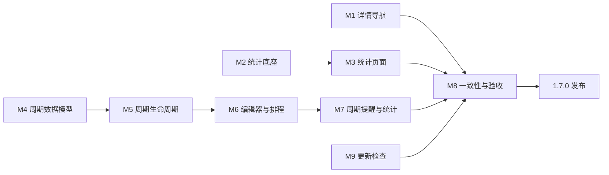

# Personal Planner 1.7.0 总改进路线图

> **For agentic workers:** REQUIRED SUB-SKILL: Use `superpowers:subagent-driven-development` (recommended) or `superpowers:executing-plans` to implement this plan task-by-task. Steps use checkbox (`- [ ]`) syntax for tracking.

**Goal:** 以已发布的 `1.6.2` 为基线，在一个 `1.7.0` 发布批次内重做统计复盘、修正日程详情导航、加入按周完成固定时长的周期目标、提供默认开启的 GitHub 更新检查，并修复会让真实可用时间被误判为“容量不足”的发布阻断问题。

**Architecture:** 四条工作流各自维护清楚的边界：统计只消费已有事实；日程导航只决定不同事项该去哪里；周期目标用模板生成普通任务实例，再交给现有排程器；更新模块只请求公开的 GitHub Release 元数据。所有工作在最后一个发布里合并，不给中间里程碑另起版本号。

**Tech Stack:** Flutter / Dart、Riverpod、GoRouter、Drift / SQLite、`fl_chart`、Windows MSIX、GitHub Releases API。

**Spec:** 本文第 3～8 节记录 2026-10-08 已确认的产品规则；第 11 节把规则拆成可执行任务。

## Global Constraints

- 已发布基线固定为 `1.6.2+37` / MSIX `1.6.2.0`，不得改写 `1.6` 的发布记录。
- 本批次对外版本为 `1.7.0`；M1～M9 都是内部里程碑，不各自发布版本。
- 最终构建号从 `+38` 起按 `docs/release/version-policy.md` 全局递增；最终 MSIX 必须高于 `1.6.2.0`。
- 本地优先不变。除用户允许的更新检查外，任务、课表、统计、偏好和数据库内容不得离开本机。
- 自动检查更新默认开启，但只检查，不静默下载、不静默安装，也不创建 Windows 计划任务或常驻服务。
- 统计主视图继续统计计划侧；周期目标的完成分钟只用于目标进度，不重新引入“计划 vs 实际”主视图。
- 周期目标的周界统一为本地时间周一 `00:00` 到下一周周一 `00:00`，前端可写作“周一至周日”。
- 周期目标默认不结转未完成分钟；上周结果保留，新一周按原目标重新开始。
- 排程容量不足时不得挤占保护时间。系统必须展示缺口并让用户决定。
- 新数据库结构必须从 schema v6 无损迁移；升级失败不得破坏原数据库。
- 每项代码改动先写失败测试，再实现；里程碑通过专项测试后才可进入下一项。
- `1.7.0` 的排程不得把已过去的时间视为可用容量；短于默认最小片段的最终剩余量必须仍可安排。

## Review Focus

- 程序跨过午夜或周一但没有重启：日期范围、周期实例和“今天”必须刷新，不得重复生成任务。
- 周期目标超过剩余容量：保护时间保持不动，预览明确给出可安排分钟和缺口分钟。
- GitHub 离线、超时、限流、返回草稿版或缺少安装资产：程序仍能启动，手动检查给出可理解的结果。
- schema v6 用户带着已有任务、课表、计划和设置升级：记录数量、外键和数据库文件保持有效。
- 150% / 200% 缩放、窄窗、键盘与读屏：统计页签、详情入口、周期编辑器和更新页都能完成主流程。

---

## 1. 发布边界

### 1.1 版本口径

| 项目 | 规则 |
| --- | --- |
| 已发布基线 | `1.6.2+37` / MSIX `1.6.2.0` |
| 下一正式版本 | `1.7.0` |
| 中间里程碑 | 只在分支和验收记录中标记，不创建 GitHub Release |
| 首个候选构建号 | `+38`，若候选代码变化则继续递增 |
| 首个 MSIX 版本 | `1.7.0.0`；只因重新打包而变化时才递增 Revision |
| 正式发布条件 | 第 12 节全部通过并完成 GitHub Release |

开发期间先保留 `pubspec.yaml` 的已发布版本，直到进入 M9 发布准备。这样不会让尚未完成的代码伪装成可交付的 `1.7.0`。

### 1.2 本批次包含

1. 今日页、日历页不同事项的正确详情入口，以及返回原页面和刷新。
2. 统计页的信息架构、口径、横轴、单位、来源追溯和午夜刷新。
3. 每周固定目标时长、具体完成时间不固定的周期目标。
4. 周期目标的进度、例外、跳过、暂停、编辑范围、排程说明、容量缺口和提醒。
5. 设置中的“立即检查更新”和默认开启的“自动检查更新”。
6. 相关撤销、空状态、错误恢复、无障碍、性能和发布验证。
7. 发布阻断级排程正确性：短任务／最终余量、历史非法片段设置、当天过去时段、预览标题与真实失败原因。

### 1.3 本批次不包含

- 手机 App、云同步、账号体系或跨设备同步。
- 月度、季度和任意 RRULE 周期；`1.7.0` 只做每周目标。
- 应用关闭后的后台更新服务。
- 静默下载、静默安装或强制更新。
- 把空白时间推断成休息，把计划时间写成实际投入，或恢复“计划 vs 实际”主视图。
- 重写课程固定日程的 `RecurrenceRules`。固定日程和周期目标保留两套不同语义。
- 完成前二次确认、近期计划冻结、可用时间可视化和“一键采用解决方案”；这些增强进入 `1.7.1`，不阻塞 `1.7.0` 当前实现链路。

## 2. 依赖顺序



M1、M2、M4、M9 可以独立开发。M5～M7 必须按顺序；M8 只做已触及流程的统一收口，不借机重写其他页面。

## 3. 已锁定的产品规则

### 3.1 统计与复盘

- 页面名称改为“计划复盘”，主标题改为“看看时间是怎么安排的”。
- 默认范围为“本周”；“今天、本周、本月、自定义范围”都以当前本地日期实时计算。
- 程序跨过午夜后自动刷新“今天”，不能继续显示昨天。
- 所有模块服从顶部范围；周期对比必须由“对比上一周期”开关显式开启。
- 不把上周、本周、本月这三个不同长度且相互重叠的周期连成折线。
- 首页先显示四项摘要：计划总时长、任务完成率、保护时间达成率、最需处理的问题。
- 主体分为四个页签：时间分配、计划质量、休息与作息、调整记录。
- 时间分配默认使用按时长降序的横向条形图，显示“小时 + 分钟”和百分比。
- 周范围按日聚合，月范围按周聚合，长自定义范围按月聚合；横轴最多显示 6～8 个标签。
- 空白时间叫“可用空闲”或“未安排”，不得叫“休息”。只有明确的保护时间才计入休息。
- 每个摘要、比例和图表项都能打开来源明细，再从明细进入任务或日程。
- 单日无法计算规律时显示原因与建议，不画没有意义的图。
- 去掉主路径上的“任意切换图表类型”。每项指标使用固定且适合其含义的图形。
- 周期目标进度单独展示，不混入领域时间分配，也不冒充完整的实际投入统计。

### 3.2 日程详情导航

- 任务进入 `/tasks/:taskId`。
- 固定日程进入对应日期的日视图，并定位该日程；若定位暂时做不到，至少进入正确日期，不能打开任务路由。
- 保护时间显示“查看保护规则”，进入 `/settings/rules`。
- 没有合法目标的事项不显示死入口。
- 点击卡片主体打开详情；“更多”菜单只放完成、跳过、调整、锁定等动作。
- 返回后保留来源页、选中日期和滚动位置；编辑成功后来源页立即刷新。

### 3.3 每周周期目标

- 模板定义每周目标分钟、领域、项目、优先级、精力、拆分方式、片段长度、期望时段和安排节奏。
- 安排节奏包括：均匀分布（默认）、尽早完成、临近截止、仅指定星期。
- 每周生成一个普通任务实例；实例继续使用现有任务详情、专注记录、计划块和重排能力。
- 数据库以“模板 ID + 周期开始日期”为唯一键，重复启动、恢复备份或跨周刷新都不能重复生成。
- 每周实例独立记录目标、已完成分钟、剩余分钟与结果；达标后不抵扣下一周。
- 专注计时和手动补记都计入本周进度。超过目标可以保留记录，但排程剩余量最低为 0。
- 点击“完成”但记录分钟不足时必须二次确认；达到目标时可以建议完成本周任务。
- 上周未达标默认不结转；可选的“结转未完成分钟”开关默认关闭。
- 支持跳过本周、仅调整本周、暂停到某日、停止以后生成、从下周修改模板。
- 删除和编辑必须区分“仅本周”“从下周开始”“整个周期”。
- 卡片显示“本周已完成 80/180 分钟”和“本段 45 分钟”，不能把已安排误写成已完成。

### 3.4 排程与容量

- 排程器以当前周期实例的剩余分钟参与滚动七天规划。
- 均匀分布不把所有片段堆到周日；周中被跳过的片段可以重新安排。
- 多个周期目标同时存在时，综合优先级、剩余比例、周期剩余时间、连续被挤压次数、精力与允许星期排序。
- 计划说明至少能给出：本周剩余、距截止天数、精力匹配、均匀分布、容量不足。
- 容量不足返回结构化缺口，不挤占保护时间，不在截止之后假装安排成功。
- 缺口卡片提供：调低本周目标、放宽期望时段、临时放宽每日上限、允许本周不完全安排。
- 所有自动调整继续遵守“先预览”和“信任自动调整”开关。

### 3.5 周期提醒

- 周四结束前进度低于 50% 时提醒一次。
- 距周期结束不足 24 小时且仍有缺口时提醒一次。
- 发现排程容量不足时立即生成一条可处理提示。
- 本周达标、跳过或暂停后停止本周提醒。
- 提醒遵守已有免打扰时段；更新提示不得混入今日任务时间线。

### 3.6 更新检查

- 设置入口显示当前版本、自动检查开关、上次检查时间、当前更新源和“立即检查”。
- 自动检查默认开启。启动约 10 秒后检查一次；运行期间最多每 24 小时请求一次。
- 关闭自动检查后不得发起后台请求；手动检查不受 24 小时限制。
- 程序关闭后不运行定时器，不创建 Windows 后台服务。
- 只请求 `ShuoZhuang/Best-Planning` 的公开 GitHub Releases 元数据，忽略 draft 和 prerelease。
- 请求设置 `User-Agent`、10 秒超时和 ETag；正确处理离线、超时、304、403/429、404 和异常 JSON。
- 有更新时显示版本号、发布日期、更新说明和 Release 页面按钮。
- 支持“跳过此版本”；更高版本仍要提醒。
- `1.7.0` 只打开 GitHub Release 页面，不在应用内下载或执行安装包。
- 首次进入更新页说明联网边界：只请求版本信息，不上传本地数据。
- 运行时版本从安装包元数据读取，移除依赖手写常量判断更新的做法。

## 4. 数据模型

### 4.1 新表 `recurring_task_templates`

| 字段 | 类型 | 规则 |
| --- | --- | --- |
| `id` | TEXT PK | 稳定 ID |
| `title` / `notes` | TEXT | 标题非空 |
| `area_id` / `project_id` | TEXT nullable | 项目必须属于所选领域 |
| `target_minutes` | INTEGER | `> 0` |
| `priority` / `energy_level` | TEXT | 复用任务枚举 |
| `split_mode` | TEXT | `splittable` / `continuous` |
| `min_chunk_minutes` / `max_chunk_minutes` | INTEGER | 正数且最小值不大于最大值 |
| `preferred_start_minute` / `preferred_end_minute` | INTEGER nullable | 成对出现 |
| `pace` | TEXT | `even` / `early` / `deadlineWeighted` / `selectedWeekdays` |
| `allowed_weekdays_mask` | INTEGER | 7 位掩码；默认周一至周日 |
| `carry_over_unfinished` | BOOLEAN | 默认 `false` |
| `starts_on_local_date` | TEXT | `YYYY-MM-DD` |
| `ends_on_local_date` | TEXT nullable | 为空表示长期有效 |
| `paused_until_local_date` | TEXT nullable | 到期后自动恢复 |
| `time_zone_id` | TEXT | 使用应用当前时区 |
| `status` | TEXT | `active` / `archived` |
| `created_at_utc` / `updated_at_utc` | INTEGER | 审计时间 |

### 4.2 新表 `recurring_task_cycles`

| 字段 | 类型 | 规则 |
| --- | --- | --- |
| `template_id` | TEXT FK | 指向模板 |
| `period_start_local_date` | TEXT | 本地周一日期 |
| `task_id` | TEXT FK UNIQUE | 指向本周生成的普通任务 |
| `base_target_minutes` | INTEGER | 模板目标快照 |
| `carry_in_minutes` | INTEGER | 默认 0 |
| `status` | TEXT | `open` / `met` / `missed` / `skipped` |
| `created_at_utc` / `updated_at_utc` | INTEGER | 审计时间 |

联合主键为 `(template_id, period_start_local_date)`。周期实例的完成分钟从现有 `time_entries` 汇总；手动补记也写入该表对应的现有时间记录，而不是再造第二套分钟事实。

### 4.3 schema v7 迁移

- 只新增两张表和索引，不改写已有 `tasks`、`time_entries`、`calendar_events`。
- `preparePlannerDatabase()` 解析出实际数据库路径后、`AppDatabase.openDefault()` 打开连接前，先用 SQLite backup API 创建一次升级前快照；不能依赖数据库已打开后才能工作的备份服务。
- 只有磁盘上的 `PRAGMA user_version < 7` 时才创建快照，文件名包含原 schema 版本和 UTC 时间；备份失败则中止升级并向用户显示可操作错误，绝不带病继续迁移。
- schema v6 → v7、空库 → v7、带外键数据的 v6 → v7 都要有自动化测试。
- 数据库生成文件由 Drift 命令生成，不手工编辑 `app_database.g.dart`。

## 5. 组件与文件边界

| 组件 | 主要文件 | 职责 |
| --- | --- | --- |
| 事项导航 | `lib/features/calendar/schedule_item_open_target.dart` | 纯函数决定任务、固定日程、保护时间的去向 |
| 统计坐标 | `lib/features/analytics/analytics_axis_policy.dart` | 聚合单位、横轴标签与抽样 |
| 统计页面 | `lib/features/analytics/analytics_page.dart` 及 `analytics_*_tab.dart` | 摘要、页签、明细入口 |
| 周期领域模型 | `lib/domain/models/recurring_task.dart` | 模板、周期、状态、编辑范围、安排节奏 |
| 周期仓库 | `lib/domain/repositories/recurring_task_repository.dart` | 模板和周期的持久化接口 |
| 周期服务 | `lib/application/recurring_task_service.dart` | 生成、结算、进度、跳过、暂停、修改范围 |
| 周期 UI | `lib/features/tasks/recurring/` | 类型选择、模板编辑、周期详情与历史 |
| 排程接入 | `lib/application/repository_schedule_problem_source.dart` | 把当前周期实例作为普通任务送进排程 |
| 更新模型 | `lib/domain/models/app_update.dart` | 版本、Release、检查结果和设置 |
| 更新客户端 | `lib/platform/update/github_release_client.dart` | 只处理 GitHub HTTP 与 JSON |
| 更新服务 | `lib/application/update_service.dart` | 版本比较、频率、跳过版本和错误映射 |
| 更新页面 | `lib/features/settings/update/update_page.dart` | 设置、状态与 Release 页面入口 |

`analytics_page.dart` 与 `task_editor_page.dart` 已经很大；本批次新增逻辑必须落入上表的新文件，不继续把数据规则塞进页面类。

## 6. 里程碑状态表

| 里程碑 | 内容 | 初始状态 | 进入下一阶段的门槛 |
| --- | --- | --- | --- |
| M1 | 详情导航 | 未开始 | 三类事项都能到正确页面且可返回 |
| M2 | 统计底座 | 未开始 | 横轴、单位、午夜刷新和范围测试通过 |
| M3 | 统计页面 | 未开始 | 四页签、摘要、来源明细和空状态通过验收 |
| M4 | 周期数据模型 | 未开始 | schema v7 迁移和唯一约束通过 |
| M5 | 周期生命周期 | 未开始 | 生成、结算、进度、跳过、暂停、修改范围通过 |
| M6 | 周期编辑与排程 | 未开始 | 七天规划、节奏、公平和缺口预览通过 |
| M7 | 周期提醒与统计 | 未开始 | 提醒去重、免打扰和周期进度通过 |
| M8 | 更新检查 | 未开始 | 手动、自动、离线、限流和跳过版本通过 |
| M9 | 收口与发布 | 未开始 | 第 12 节全部完成并发布 `1.7.0` |

状态只允许：`未开始`、`实施中`、`待人工验收`、`待发布`、`已发布`、`阻塞`。改变状态时必须附测试输出或人工验收记录。

## 7. 全局验收口径

### 7.1 统计

- 横轴一个数据点最多出现一个标签；不存在重复“上周”或重复日期。
- 周范围显示 7 个或更少标签，月范围与长范围按规则抽样。
- 主图数值不显示裸分钟，例如 `1195` 必须显示为 `19 小时 55 分钟`。
- “今天”在午夜后更新；10 月 8 日不能继续显示 10 月 7 日范围。
- 空白时间不使用“休息”字样。
- 所有比例显示分子与分母，所有图表项能查看来源。

### 7.2 周期目标

- 连续启动十次，同一模板同一周只有一个周期实例。
- 目标 180 分钟、已记录 80 分钟时，排程输入只剩 100 分钟。
- 不结转时，下周目标恢复 180 分钟；上周保留未达标记录。
- 跳过本周不归档模板；暂停到期后能够继续生成。
- 容量只有 120 分钟时，保护时间不变，界面显示缺口 60 分钟。
- 三个以上周期目标竞争时，结果不依赖数据库返回顺序。

### 7.3 更新检查

- 设置页首次打开即显示当前安装版本。
- 自动检查默认开启；24 小时内不会重复请求。
- 手动检查总能立即发起；关闭自动检查后不再自动联网。
- 离线和 GitHub 限流不影响启动，不把堆栈或本地路径展示给用户。
- draft、prerelease、非法 tag 和低于当前版本的 Release 不提示更新。
- 点击“查看下载”只打开已验证的仓库 Release HTTPS 地址。

## 8. 人工体验脚本

1. 在今日页分别打开一个任务、固定课程和午餐保护时间，返回后确认仍停留在原位置。
2. 将系统日期跨过午夜，不重启程序，确认“今天”、统计范围和日历日期更新。
3. 新建“每周英语 180 分钟”，选择均匀分布，生成计划并检查没有全部挤到周日。
4. 完成其中 80 分钟，再生成计划，确认只安排剩余 100 分钟。
5. 跳过本周，确认下周仍会生成；再暂停到两周后，确认暂停期不生成。
6. 人为制造只有 120 分钟空闲的场景，确认 60 分钟缺口可见且保护时间没有变化。
7. 关闭网络分别进行自动检查和手动检查；前者不打扰，后者给出短消息。
8. 恢复网络后检查更新，确认最新版、更新说明、跳过版本和 Release 链接正确。
9. 在 150% 和 200% 缩放下走完统计、周期编辑、详情返回和更新检查。

## 9. 测试分层

| 层级 | 覆盖内容 |
| --- | --- |
| 纯 Dart 单元测试 | 周界、周期唯一键、结转、进度、节奏、公平排序、版本比较、横轴抽样 |
| Repository / Drift | schema v6→v7、模板与周期事务、外键、唯一约束、恢复备份后的幂等生成 |
| Widget | 四页签、来源明细、类型选择、周期编辑、容量缺口、更新页状态 |
| Router | 三类事项详情、返回来源、固定日程定位、更新设置入口 |
| Integration | 跨周生成、周期任务进计划、离线检查、手动检查、升级数据库 |
| Windows 人工 | MSIX 覆盖安装、系统缩放、通知点击、GitHub Release 下载页 |

## 10. 提交策略

- 每个任务使用一个可回滚提交；测试与实现放在同一提交里。
- 不把所有 M1～M9 压成一个巨型提交。
- 推荐前缀：`fix(today)`、`feat(analytics)`、`feat(recurring)`、`feat(update)`、`test(release)`、`docs(release)`。
- 任一任务未通过自己的专项测试，不得进入下一个依赖任务。
- 不提交 `build/`、数据库、用户课表原图、`.pfx`、日志或下载的 Release 资产。

## 11. 实施任务

### Task 1: 固定版本基线与验收目录

**Files:**
- Modify: `docs/release/version-policy.md`
- Create: `docs/testing/v1.7-acceptance.md`
- Create: `docs/release/1.7.0-release-notes.md`

**Interfaces:**
- Consumes: 已发布的 `1.6.2+37` 记录。
- Produces: 本路线图所有任务共用的状态登记位置；不修改运行时代码版本。

- [ ] **Step 1:** 在版本规则中登记“`1.7.0` 是新功能发布线，M1～M9 不各自发布”。
- [ ] **Step 2:** 建立验收表，逐项复制第 7、8、12 节，不写“待补充”等占位词。
- [ ] **Step 3:** 建立 Release Notes 骨架，只列已确认范围；完成情况随任务更新。
- [ ] **Step 4:** 运行 `git diff --check`，期望退出码 0。
- [ ] **Step 5:** 提交：`docs(release): open 1.7 product improvement line`。

### Task 2: 修复今日页详情导航

**Files:**
- Create: `lib/features/calendar/schedule_item_open_target.dart`
- Modify: `lib/features/today/today_page.dart`
- Modify: `lib/app/router.dart`
- Test: `test/features/calendar/schedule_item_open_target_test.dart`
- Test: `test/features/today/today_page_test.dart`
- Test: `test/app/today_route_test.dart`

**Interfaces:**
- Produces: `ScheduleItemOpenTarget? resolveScheduleItemOpenTarget(ScheduleViewItem item, DateTime dayStartUtc)`。
- Targets: `TaskOpenTarget(taskId)`、`DayOpenTarget(dayStartUtc, eventId)`、`PlanningRulesOpenTarget()`。

- [ ] **Step 1:** 写失败测试，证明固定日程和保护时间当前不能走任务详情，缺少目标时返回 `null`。
- [ ] **Step 2:** 运行三个专项测试，确认新断言失败且失败原因指向未实现的目标解析。
- [ ] **Step 3:** 实现纯目标解析器；任务以非空 `taskId` 为准，固定日程使用 `fixedEventId(item)`，保护时间进入规划规则。
- [ ] **Step 4:** 卡片主体接入打开动作；菜单按事项类型显示“查看详情”“查看当天”或“查看保护规则”。
- [ ] **Step 5:** 路由使用解析结果，不再对 `item.taskId` 使用无条件 `!`。
- [ ] **Step 6:** 增加返回与刷新测试；任务、固定日程、保护时间各覆盖一次。
- [ ] **Step 7:** 运行专项测试，期望全部通过。
- [ ] **Step 8:** 提交：`fix(today): route each schedule item to a valid detail target`。

### Task 3: 修正统计范围、横轴和单位

**Files:**
- Create: `lib/features/analytics/analytics_axis_policy.dart`
- Modify: `lib/features/analytics/chart_view.dart`
- Modify: `lib/features/analytics/analytics_page.dart`
- Test: `test/features/analytics/analytics_axis_policy_test.dart`
- Test: `test/features/analytics/analytics_custom_range_test.dart`
- Test: `test/features/analytics/analytics_page_test.dart`

**Interfaces:**
- Produces: `AnalyticsBucketPlan analyticsBucketPlan(DateTimeRange localRange, double availableWidth)`。
- Produces: `List<AxisTick> analyticsAxisTicks(List<AnalyticsBucket> buckets, int maxLabels)`。

- [ ] **Step 1:** 写失败测试：3 个数据点只出现 3 个标签；7 日、31 日和 365 日范围不超过标签上限。
- [ ] **Step 2:** 写失败测试：默认范围是本周；跨午夜后重算今天，不复用启动时的旧日期。
- [ ] **Step 3:** 实现按日、周、月的聚合计划和整数刻度；禁止对任意小数刻度直接 `round()` 后画标签。
- [ ] **Step 4:** 图表增加明确单位和悬停明细；用户可见值统一走“小时 + 分钟”格式化。
- [ ] **Step 5:** 把“对比上一周期”做成显式开关，关闭时所有模块只使用顶部范围。
- [ ] **Step 6:** 运行专项测试，期望全部通过。
- [ ] **Step 7:** 提交：`fix(analytics): align ranges axes and time units`。

### Task 4: 重排统计页面并加入来源明细

**Files:**
- Create: `lib/features/analytics/analytics_overview.dart`
- Create: `lib/features/analytics/analytics_time_allocation_tab.dart`
- Create: `lib/features/analytics/analytics_plan_quality_tab.dart`
- Create: `lib/features/analytics/analytics_rest_tab.dart`
- Create: `lib/features/analytics/analytics_adjustments_tab.dart`
- Create: `lib/features/analytics/analytics_drilldown_sheet.dart`
- Modify: `lib/features/analytics/analytics_page.dart`
- Modify: `lib/application/analytics_service.dart`
- Modify: `lib/data/database/daos/analytics_dao.dart`
- Test: `test/features/analytics/analytics_review_sections_test.dart`
- Test: `test/features/analytics/analytics_drilldown_test.dart`
- Test: `test/application/analytics_service_test.dart`

**Interfaces:**
- Produces: `AnalyticsBreakdown`，包含稳定实体 ID、标题、分钟、领域色和目标路由。
- Consumes: Task 3 的 `AnalyticsBucketPlan` 与时间格式化。

- [ ] **Step 1:** 写失败测试，固定四项摘要、四页签和默认“时间分配”页签。
- [ ] **Step 2:** 写失败测试，空白时间显示“可用空闲/未安排”，页面中不出现“空着的休息”。
- [ ] **Step 3:** 写服务测试，每个摘要、领域和比例都能返回可追溯来源，合计与主指标一致。
- [ ] **Step 4:** 把现有长页面拆成六个聚焦组件；移除主路径上的图表类型选择器。
- [ ] **Step 5:** 时间分配使用降序横向条形图；计划质量显示分子/分母；休息页只把保护时间计为休息。
- [ ] **Step 6:** 实现来源明细底部面板与任务/日程跳转；无来源时给出解释，不显示空列表。
- [ ] **Step 7:** 对单日、空数据、仅固定日程、仅保护时间和跨年范围运行 Widget 测试。
- [ ] **Step 8:** 提交：`feat(analytics): rebuild plan review around clear sections`。

### Task 5: 建立周期目标领域模型与 schema v7

**Files:**
- Create: `lib/domain/models/recurring_task.dart`
- Create: `lib/domain/repositories/recurring_task_repository.dart`
- Modify: `lib/app/backup_assembly.dart`
- Modify: `lib/main.dart`
- Modify: `lib/data/database/tables/planner_tables.dart`
- Modify: `lib/data/database/app_database.dart`
- Create: `lib/data/database/daos/recurring_task_dao.dart`
- Create: `lib/data/repositories/drift_recurring_task_repository.dart`
- Test: `test/app/pre_migration_backup_test.dart`
- Test: `test/domain/recurring_task_test.dart`
- Test: `test/data/recurring_task_dao_test.dart`
- Test: `test/drift/app_database/schema_migration_test.dart`

**Interfaces:**
- Produces: `RecurringTaskTemplate`、`RecurringTaskCycle`、`RecurringPace`、`RecurringCycleStatus`、`RecurringEditScope`。
- Produces: `RecurringTaskRepository` 的模板 CRUD、周期查询和事务性 `createCycleIfAbsent`。
- Produces: `createPreMigrationSnapshotIfNeeded(databasePath, targetSchemaVersion)`；返回快照路径或 `null`，且必须在打开 Drift 连接前调用。

- [ ] **Step 1:** 写领域失败测试，覆盖目标分钟、片段范围、项目归属、日期范围和星期掩码验证。
- [ ] **Step 2:** 写 Repository 失败测试，两个并发生成请求只能创建一个 `(templateId, periodStartLocalDate)` 周期。
- [ ] **Step 3:** 写升级前快照失败测试：v6 库会在连接打开前生成可读取副本，v7 库不重复备份，备份写入失败会阻止数据库启动。
- [ ] **Step 4:** 写 v6→v7 失败测试，记录迁移前后的任务、日程、设置、计划块数量和外键检查结果。
- [ ] **Step 5:** 在数据库启动装配中接入升级前快照，再添加两张表、索引和 schema v7 migration；运行 Drift 生成命令更新生成文件。
- [ ] **Step 6:** 实现 DAO 与 Repository；模板、周期和普通任务创建必须处于一个事务。
- [ ] **Step 7:** 运行升级前备份、领域、DAO 与迁移测试，期望全部通过。
- [ ] **Step 8:** 提交：`feat(recurring): add weekly goal storage and migration`。

### Task 6: 实现周期生成、结算与进度

**Files:**
- Create: `lib/application/recurring_task_service.dart`
- Create: `lib/application/recurring_period.dart`
- Modify: `lib/application/task_service.dart`
- Modify: `lib/application/focus_service.dart`
- Test: `test/application/recurring_period_test.dart`
- Test: `test/application/recurring_task_service_test.dart`
- Test: `test/application/recurring_task_progress_test.dart`

**Interfaces:**
- Produces: `WeeklyPeriod weeklyPeriodFor(DateTime nowUtc, String timeZoneId)`。
- Produces: `Future<List<RecurringTaskCycle>> ensureCycles(TimeRange window, DateTime nowUtc)`。
- Produces: `Future<RecurringProgress> progressForCycle(String templateId, DateTime periodStartLocalDate)`。
- Produces: `skipCycle`、`pauseTemplate`、`updateTemplate(scope)`、`recordManualMinutes`。

- [ ] **Step 1:** 写周界失败测试，覆盖周日→周一、跨年、时区转换和程序跨周未重启。
- [ ] **Step 2:** 写幂等生成失败测试，覆盖重复启动、重复调用、恢复备份后重跑。
- [ ] **Step 3:** 写进度失败测试：180 目标、80 已记录、剩余 100；超额记录时剩余为 0。
- [ ] **Step 4:** 写结算失败测试：未达标保留 `missed`，默认下周目标不结转；开启结转时写入 `carryInMinutes`。
- [ ] **Step 5:** 实现周期服务并复用 `time_entries` 汇总专注和手动记录。
- [ ] **Step 6:** 实现跳过本周、暂停到期、停止以后生成，以及三个编辑范围。
- [ ] **Step 7:** 运行专项测试，期望全部通过。
- [ ] **Step 8:** 提交：`feat(recurring): generate and settle weekly goal cycles`。

### Task 7: 新建类型选择与周期目标页面

**Files:**
- Create: `lib/features/tasks/task_type_chooser.dart`
- Create: `lib/features/tasks/recurring/recurring_task_editor_page.dart`
- Create: `lib/features/tasks/recurring/recurring_task_detail_page.dart`
- Create: `lib/features/tasks/recurring/recurring_history_list.dart`
- Modify: `lib/features/tasks/task_editor_page.dart`
- Modify: `lib/features/tasks/task_list_page.dart`
- Modify: `lib/app/router.dart`
- Test: `test/features/tasks/task_type_chooser_test.dart`
- Test: `test/features/tasks/recurring/recurring_task_editor_test.dart`
- Test: `test/features/tasks/recurring/recurring_task_detail_test.dart`
- Test: `test/app/recurring_task_route_test.dart`

**Interfaces:**
- Consumes: Task 6 的周期服务。
- Produces: `/tasks/new/type`、`/tasks/recurring/new`、`/tasks/recurring/:templateId` 路由。

- [ ] **Step 1:** 写失败测试，新建入口提供普通任务、周期目标、固定日程、保护时间四种清楚的去向。
- [ ] **Step 2:** 写编辑器失败测试，默认周一至周日、均匀分布、不结转；领域先于项目，项目按领域过滤。
- [ ] **Step 3:** 写详情失败测试，显示本周进度、本段分钟、历史周次和编辑/删除影响范围。
- [ ] **Step 4:** 实现类型选择器和周期编辑器；无关字段不出现在当前表单。
- [ ] **Step 5:** 实现周期详情、手动补记、跳过本周、暂停和停止以后生成。
- [ ] **Step 6:** 完成不足目标的二次确认，以及达标后的完成建议。
- [ ] **Step 7:** 运行专项测试与 150%/200% 缩放 Widget 测试。
- [ ] **Step 8:** 提交：`feat(recurring): add weekly goal creation and management`。

### Task 8: 把周期目标接入排程与预览

**Files:**
- Create: `lib/domain/models/capacity_shortfall.dart`
- Create: `lib/domain/services/recurring_task_priority.dart`
- Modify: `lib/application/repository_schedule_problem_source.dart`
- Modify: `lib/application/planning_service.dart`
- Modify: `lib/features/planning/plan_preview_page.dart`
- Modify: `lib/features/today/today_page.dart`
- Modify: `lib/features/calendar/week_view/schedule_view_source.dart`
- Test: `test/domain/recurring_task_priority_test.dart`
- Test: `test/application/recurring_planning_test.dart`
- Test: `test/features/planning/recurring_shortfall_preview_test.dart`
- Test: `test/features/today/recurring_progress_test.dart`

**Interfaces:**
- Produces: `RecurringTaskRank rankRecurringTask(RecurringSchedulingContext context)`。
- Produces: `CapacityShortfall`，包含模板、目标、可安排、缺口和受保护约束。
- Consumes: Task 6 的当前周期与剩余分钟。

- [ ] **Step 1:** 写失败测试，均匀分布不会把 180 分钟全部安排到周日。
- [ ] **Step 2:** 写失败测试，多个周期目标换一种数据库返回顺序后，排程结果保持一致。
- [ ] **Step 3:** 写失败测试，容量不足时返回精确缺口且保护时间逐值不变。
- [ ] **Step 4:** 把周期实例作为普通任务输入排程；排序补充周期剩余比例、距结束时间和连续被挤压次数。
- [ ] **Step 5:** 把安排节奏转换为评分或允许星期约束，不另写第二个排程器。
- [ ] **Step 6:** 预览页显示原因与缺口处理动作；任何规则变化仍经过预览/信任自动调整流程。
- [ ] **Step 7:** 今日和日历卡片显示本周进度与本段分钟，安排和完成使用不同文案。
- [ ] **Step 8:** 运行专项测试，期望全部通过。
- [ ] **Step 9:** 提交：`feat(planning): schedule weekly goals without consuming protected time`。

### Task 9: 周期提醒与统计进度

**Files:**
- Create: `lib/application/recurring_notification_service.dart`
- Create: `lib/features/analytics/recurring_goal_summary.dart`
- Modify: `lib/application/notification_service.dart`
- Modify: `lib/features/settings/notifications/notification_preferences_section.dart`
- Modify: `lib/features/analytics/analytics_page.dart`
- Test: `test/application/recurring_notification_service_test.dart`
- Test: `test/features/analytics/recurring_goal_summary_test.dart`
- Test: `test/features/settings/notification_preferences_section_test.dart`

**Interfaces:**
- Consumes: 周期进度、现有免打扰设置和 `NotificationPort`。
- Produces: `RecurringGoalSummary`，只包含目标数量、达标、进行中、未达标和连续达标周数。

- [ ] **Step 1:** 写失败测试，周四低于 50%、不足 24 小时和容量不足各提醒一次。
- [ ] **Step 2:** 写失败测试，达标、跳过、暂停后不再提醒，免打扰推迟而非丢失必要提醒。
- [ ] **Step 3:** 实现提醒去重键 `(templateId, periodStart, kind)`，避免每次启动重复通知。
- [ ] **Step 4:** 统计页加入周期目标摘要；不把完成分钟混进领域计划时长。
- [ ] **Step 5:** 实现摘要来源明细，能打开对应周期详情。
- [ ] **Step 6:** 运行专项测试，期望全部通过。
- [ ] **Step 7:** 提交：`feat(recurring): add goal reminders and progress review`。

### Task 10: GitHub 更新检查服务

**Files:**
- Create: `lib/domain/models/app_update.dart`
- Create: `lib/platform/update/github_release_client.dart`
- Create: `lib/application/update_service.dart`
- Create: `lib/application/app_version_provider.dart`
- Modify: `pubspec.yaml`
- Modify: `lib/app/backup_assembly.dart`
- Test: `test/platform/update/github_release_client_test.dart`
- Test: `test/application/update_service_test.dart`
- Test: `test/app/version_consistency_test.dart`

**Interfaces:**
- Produces: `Future<AppVersion> currentVersion()`。
- Produces: `Future<UpdateCheckResult> check({required bool manual})`。
- Produces: `UpdateSettings(autoCheckEnabled, lastCheckedUtc, skippedVersion, etag)`。

- [ ] **Step 1:** 写版本比较失败测试，覆盖 `1.7.0`、`v1.7.0`、低版本、相同版本、非法 tag、draft 和 prerelease。
- [ ] **Step 2:** 写客户端失败测试，覆盖 200、304、403/429、404、超时、离线和异常 JSON。
- [ ] **Step 3:** 添加 `http`、`package_info_plus`、`url_launcher` 直接依赖并锁定到 `pubspec.lock`。
- [ ] **Step 4:** 实现 GitHub 客户端，固定仓库、HTTPS、Accept、User-Agent、ETag 与 10 秒超时。
- [ ] **Step 5:** 实现更新服务；自动检查遵守 24 小时与开关，手动检查立即请求。
- [ ] **Step 6:** 运行时版本改从安装包元数据读取；备份清单通过注入的版本提供者写版本。
- [ ] **Step 7:** 运行专项测试，期望全部通过。
- [ ] **Step 8:** 提交：`feat(update): check stable GitHub releases safely`。

### Task 11: 更新设置页面与启动调度

**Files:**
- Create: `lib/features/settings/update/update_page.dart`
- Create: `lib/application/update_check_scheduler.dart`
- Modify: `lib/features/settings/settings_hub_page.dart`
- Modify: `lib/app/planner_app.dart`
- Modify: `lib/app/router.dart`
- Test: `test/features/settings/update_page_test.dart`
- Test: `test/application/update_check_scheduler_test.dart`
- Test: `test/app/update_route_test.dart`

**Interfaces:**
- Consumes: Task 10 的 `UpdateService`。
- Produces: `/settings/update`；`UpdateCheckScheduler.start()` 和 `dispose()`。

- [ ] **Step 1:** 写页面失败测试，默认开启、当前版本、上次检查、立即检查、跳过版本和隐私说明都可见。
- [ ] **Step 2:** 写调度失败测试，启动 10 秒后检查；24 小时内不重复；关闭开关后不请求。
- [ ] **Step 3:** 实现设置持久化、加载/检查/有更新/无更新/失败/跳过六种界面状态。
- [ ] **Step 4:** “查看下载”只允许打开 `https://github.com/ShuoZhuang/Best-Planning/releases/...`。
- [ ] **Step 5:** 自动失败使用非打扰提示；手动失败显示具体但不泄露堆栈的原因。
- [ ] **Step 6:** 调度器随应用生命周期启动和释放，不创建系统后台任务。
- [ ] **Step 7:** 运行专项测试，期望全部通过。
- [ ] **Step 8:** 提交：`feat(settings): add manual and automatic update checks`。

### Task 12: 撤销、空状态与提示一致性

**Files:**
- Create: `lib/design/planner_action_feedback.dart`
- Modify: `lib/features/today/today_page.dart`
- Modify: `lib/features/tasks/recurring/recurring_task_detail_page.dart`
- Modify: `lib/features/analytics/analytics_page.dart`
- Modify: `lib/features/settings/update/update_page.dart`
- Test: `test/design/planner_action_feedback_test.dart`
- Test: corresponding feature tests

**Interfaces:**
- Produces: 统一的短暂成功提示、可撤销动作和可关闭长期提示。

- [ ] **Step 1:** 写失败测试，完成、跳过本次、修改本周目标和暂停周期都有撤销入口。
- [ ] **Step 2:** 写失败测试，同一长期提示关闭后不重复出现；新 proposal 或新版本可以再次出现。
- [x] **Step 3:** 为无统计、无确认计划、周期未安排、无更新和数据不足提供下一步操作。（`test/features/analytics/analytics_empty_state_test.dart` 6 项；实现见 `6de397e`。其中"无统计／无确认计划"与"无保护时间"两处本轮补上动作按钮；"周期未安排"由缺口卡片四动作承担、"无更新"由更新页"立即检查"承担、"数据不足"由来源明细解释承担——那三处本来就有下一步）
- [ ] **Step 4:** 保证长期横幅不遮挡底部内容，键盘可聚焦关闭按钮，读屏能播报状态变化。
- [ ] **Step 5:** 运行相关 Widget 与语义测试。
- [ ] **Step 6:** 提交：`feat(ui): make status messages actionable and reversible`。

### Task 12A: 修复 1.7.0 排程发布阻断问题

**Files:**
- Modify: `lib/scheduling/candidate_generator.dart`
- Modify: `lib/scheduling/schedule_engine.dart`
- Modify: `lib/application/task_service.dart`
- Modify: `lib/features/tasks/task_editor_page.dart`
- Modify: `lib/features/planning/plan_preview_page.dart`
- Modify: `lib/data/database/app_database.dart`
- Test: `test/scheduling/candidate_generator_test.dart`
- Test: `test/scheduling/schedule_engine_test.dart`
- Test: `test/application/task_service_test.dart`
- Test: `test/features/tasks/task_editor_page_test.dart`
- Test: `test/features/planning/plan_preview_test.dart`
- Test: `test/drift/app_database/schema_migration_test.dart`

**Interfaces:**
- 排程片段规则：`effectiveMinChunk = min(configuredMinChunk, remainingMinutes)`；最后一段允许短于模板最小片段，但不得小于排程粒度之外的实际剩余量。
- 新建与编辑规则：预计时长缩短后，默认或继承的片段上下限同步夹紧到合法范围；服务层拒绝无法解释的非法组合。
- 迁移规则：schema v7 → v8 只修复 `min_chunk_minutes > max_chunk_minutes`、片段上下限超过任务总时长等历史非法设置，不改任务剩余量、截止时间与用户文本。
- 时间规则：当天滚动规划的起点不得早于当前时间向上取整到排程粒度后的时刻。
- 预览规则：所有变更与冲突优先显示任务标题；失败原因区分“连续时长不足”“受开始时间限制”“受期望时段限制”“达到每日上限”等真实约束，不再只显示 UUID 与笼统“可用时间不足”。

- [x] **Step 1:** 写失败测试复现：15 分钟可拆分任务、默认片段 30–90 分钟、当天仍有 15 分钟合法空档时必须排入，而不是同时出现在“新增”和“未安排”。（`test/scheduling/short_remainder_test.dart`，9 项；实现见 `899b110`）
- [x] **Step 2:** 写失败测试：剩余 15 分钟但原任务最小片段 30 分钟时，最终余量仍能安排；非最终片段继续遵守最小片段。（同上）
- [x] **Step 3:** 写失败测试：新建或编辑把预计时长改成 15 分钟后，保存值规范为合法片段范围，服务层与界面层得到同一结果。（`test/application/task_chunk_normalization_test.dart`，9 项；实现见 `899b110`）
- [x] **Step 4:** 写 v7 → v8 迁移失败测试，覆盖短任务、`min > max`、重复打开幂等和真实 v6 → v8 连续迁移。（`test/drift/app_database/v8_chunk_repair_test.dart`，7 项；实现见 `f258a76`）
- [x] **Step 5:** 写失败测试：当天 15:30 生成计划时，任何新增块不得落在 15:30 之前；跨日窗口仍按各日本地边界计算。（`test/application/rolling_plan_start_test.dart`，3 项；实现见 `8b5ccf6`）
- [x] **Step 6:** 写失败测试：预览显示任务标题与结构化失败原因，不显示裸 UUID；同一块不得同时被归为已新增和未安排。（引擎侧 `test/scheduling/unscheduled_reason_test.dart` 10 项 + 展示侧 `test/features/planning/unscheduled_display_test.dart` 11 项；实现见 `36b4018`、`5159d7d`）
- [x] **Step 7:** 以最小改动实现候选生成、输入规范化、迁移修复、时间下界和预览映射；不引入 `1.7.1` 的冻结或一键修复逻辑。（`899b110`、`f258a76`、`8b5ccf6`、`36b4018`、`5159d7d`）
- [x] **Step 8:** 运行排程、任务编辑、迁移、预览以及真实数据回归测试，期望全部通过。（全量 **1553 通过 / 0 失败**；analyze 0 问题；format 449 文件 0 改动。真实数据 v6 → v8 连续迁移见 `f258a76` 的 `v8_chunk_repair_test.dart`）
- [x] **Step 9:** 提交：`fix(planning): schedule short remainders in real available time`。（拆成可回滚的多次提交而不是一个：`899b110`（Step 1–3）、`8b5ccf6`（Step 5）、`f258a76`（Step 4 迁移）、`36b4018`（Step 6 引擎）、`5159d7d`（Step 6 展示）。另有一个前置修复 `b9a38c3`：`8273673` 提交了 `allowedWeekdaysMask` / `maxMinutesPerLocalDay` 的使用却没有提交字段定义，干净 HEAD 上 8 个测试文件编译不过）

#### Task 12A Step 6 实施约束（2026-10-08 用户决定，架构调整）

这是一个跨排程层与展示层的接口决策。**以下五条是实现约束，不是建议**；改动前先读这一节。

1. **标题归展示装配层，排程引擎不携带标题。** 新增端口：

   ```dart
   abstract interface class TaskTitleLookup {
     Future<String?> titleFor(String taskId);
   }
   ```

   并且**必须提供批量接口**，避免逐条查询：

   ```dart
   Future<Map<String, String>> titlesFor(Iterable<String> taskIds);
   ```

   `UnscheduledTask` 保持领域对象属性，不加 `title`。理由：引擎只需要任务约束，不该依赖数据库或
   界面文案；标题可能被用户修改，放进引擎输出容易产生旧快照；固定日程与周期实例以后也可以各自
   提供标题查询实现。**查询失败时显示“未命名任务”，仍然不得退回裸 UUID。**

2. **失败原因必须由引擎输出，预览层不得推测。**

   ```dart
   enum UnscheduledReasonCode {
     availableTimeNotReached,
     deadlineWindowTooShort,
     continuousGapTooShort,
     minimumChunkTooLarge,
     dailyLimitReached,
     protectedTimeOccupied,
     fixedScheduleOccupied,
     lockedPlanOccupied,
     requiredBreakUnavailable,
     insufficientCapacity,
   }

   final class UnscheduledReason {
     const UnscheduledReason({
       required this.code,
       this.requiredMinutes,
       this.availableMinutes,
       this.constraintLabel,
     });
     final UnscheduledReasonCode code;
     final int? requiredMinutes;
     final int? availableMinutes;
     final String? constraintLabel;
   }
   ```

   `UnscheduledTask` 增加 `primaryReason` 与 `reasons`（默认空列表）。

3. **不采用“最后一次被拒绝的约束”。** 那取决于候选遍历顺序，不一定真正原因——例如一个连续任务
   可能同时被保护时间切碎、又达到每日上限，最后碰巧检查到休息间隔。正确做法是：候选检查过程中
   **累计全部拒绝证据**，排程结束后为未安排任务生成 `reasons`，再按**稳定优先级**选 `primaryReason`。
   预览显示主原因，并允许展开查看其他限制。

   主原因优先级（从高到低）：尚未到任务开始时间 → 截止前窗口不足 → 找不到足够长的连续空档 →
   最小片段大于剩余量 → 达到每日任务上限 → 固定日程／保护时间／锁定块占用 → 无法满足片段间休息 →
   兜底的总体容量不足。

4. **`preferredWindow` 是软偏好，不得作为未安排主原因。** 引擎可以排到期望时段之外，因此不能声称
   任务“因期望时段限制而无法安排”。只有两种合法处理：继续作为软偏好，显示“期望时段内空间不足，
   已尝试其他时间”，但不作为主原因；或将来增加明确的“必须在此时段”开关，届时才能新增
   `requiredWindowUnavailable`。**本批次不做那个开关。**

5. **预览文案。** 主行是「标题 + 还缺多少分钟」，下一行是「原因：<主原因的人话>」，其他限制另起
   一行。例如：

   > 贫困生材料提交还缺 15 分钟
   > 原因：任务要求连续 30 分钟，但截止前最长空档只有 20 分钟。

   > 每周英语还缺 60 分钟
   > 原因：本周已达到每日可移动任务上限。
   > 其他限制：午餐和固定休息时间保持不变。


### 1.7.1 已确认后续增强（不阻塞本路线图）

- 完成任务前根据实际记录给出二次确认，避免误把“点完成”当成已投入足够时间。
- 默认冻结近期 30 分钟内已经确认的安排，除非用户主动允许重排。
- 在今日页或预览页可视化“固定／保护／已占用／可用”时间来源，并复用同一份容量快照解释冲突。
- 对结构化缺口提供可预览的一键方案，例如缩短片段、放宽期望时段或调整当天上限。

### Task 13: 完整验证与 1.7.0 发布

**Files:**
- Modify: `pubspec.yaml`
- Modify: `lib/app/backup_assembly.dart` 或新的版本装配点
- Modify: `docs/release/version-policy.md`
- Modify: `docs/release/build-ledger.md`
- Modify: `docs/release/1.7.0-release-notes.md`
- Create: `docs/release/1.7.0-user-guide.md`
- Modify: `README.md`
- Modify: `docs/testing/v1.7-acceptance.md`

**Interfaces:**
- Consumes: M1～M8 的代码和验收证据。
- Produces: 已签名 MSIX、便携 ZIP、校验值、用户指南和 GitHub Release。

- [x] **Step 1:** 生成压力数据：500 条任务、2000 个计划片段、20 个周期模板、一学期课程和一年统计范围。（`test/application/scale_smoke_test.dart`，9 项；实测 1.6 秒，见验收表 §5.4。**注意**：块密度而非任务数是成本主导，长窗口 + 数千块会让引擎的重叠检查退化成 `候选数 × 块数`）
- [x] **Step 2:** 运行格式检查：`dart format --output=none --set-exit-if-changed lib test integration_test`，期望 0 改动。（**450 文件 0 改动**，exit 0）
- [x] **Step 3:** 运行静态分析：`flutter analyze --no-pub`，期望 0 问题。（**No issues found!**）
- [x] **Step 4:** 运行完整测试：`flutter test --no-pub`，期望 0 失败。（**1562 通过 / 0 失败**）
- [x] **Step 5:** 逐条运行集成测试，覆盖首次计划、详情导航、周期目标、统计页、课表导入、更新检查和备份恢复。（八个文件全部通过，见验收表 §5.5；实现/修正在 `4254b3c`。跑之前必须先执行 `prepare-windows-build.ps1`——集成测试会真的构建 Windows 应用，因此同样受符号链接限制影响）
- [x] **Step 6:** 从真实 `1.6.2` 数据库执行 v6→v8 连续升级；比较升级前后核心表数量、任务字段修复范围和 `PRAGMA foreign_key_check`（数据库文件哈希因合法迁移必然变化，不以“哈希相同”作为成功条件）。（`b252e7d`；实测 `tasks=10 illegalBefore=8 illegalAfter=0 user_version=8`，见验收表 §5.2b）
- [ ] **Step 7:** 完成第 8 节人工脚本，并保存截图和结果。
- [ ] **Step 8:** 将版本设为 `1.7.0+N`、MSIX 设为高于 `1.6.2.0` 的 `1.7.0.R`；运行版本一致性测试。
- [ ] **Step 9:** 构建 Windows Release、便携 ZIP、签名 MSIX、`.cer`、安装脚本和 SHA-256 清单。
- [ ] **Step 10:** 在未安装环境做全新安装，在已装 `1.6.2` 环境做覆盖升级；两条路径均验证启动、数据和周期唯一性。
- [ ] **Step 11:** 扫描交付物，确认没有数据库、备份、用户图片、`.pfx`、私钥和诊断日志。
- [ ] **Step 12:** 更新 README、用户指南、Release Notes、版本规则和构建台账；内容与资产名称逐字一致。
- [ ] **Step 13:** 创建 GitHub Release，上传 MSIX、ZIP、`.cer`、安装脚本、说明和校验文件；下载后复核哈希。
- [ ] **Step 14:** 把里程碑状态改为“已发布”，提交：`chore(release): publish Personal Planner 1.7.0`。

## 12. 正式发布门槛

只有同时满足以下条件，才可以说 `1.7.0` 已完成并正式发布：

- [ ] M1～M8 的专项测试和验收记录全部通过，没有“部分完成”或未解释的跳过测试。
- [ ] 完整 `flutter test`、`flutter analyze`、格式检查和 Windows Release 构建全部通过。
- [ ] schema v6→v8 在真实 `1.6.2` 数据上连续升级成功，除明确规范化的非法片段字段外，数据和外键检查通过。
- [ ] 详情导航三类事项、统计四页签、周期目标完整闭环、更新检查都经过人工操作。
- [ ] 150% / 200% 缩放、窄窗、键盘和读屏的主流程可完成。
- [ ] 离线、GitHub 限流、容量不足、跨午夜、跨周和重复启动均有自动化证据。
- [ ] 已签名 MSIX 能从 `1.6.2` 覆盖安装；卸载和升级不删除用户数据库。
- [ ] GitHub Release 已创建，下载资产与 README、用户指南、Release Notes、哈希一致。
- [ ] 用户完成候选安装包体验确认，构建台账才登记“已发布”。

## 13. 路线图维护规则

- 执行者只勾选有证据的步骤；测试命令、通过数量、安装包路径或人工截图写入 `docs/testing/v1.7-acceptance.md`。
- 发现新需求先判断是否属于第 1.2 节。超出范围的内容进入后续版本，不塞入 `1.7.0`。
- 若产品规则变化，先修改本文并记录日期与决定，再修改代码。
- 任一 Agent 不得仅凭已有文档中的旧测试数字宣称当前工作树通过；发布前必须重新运行 Task 13 中列出的验证命令。
